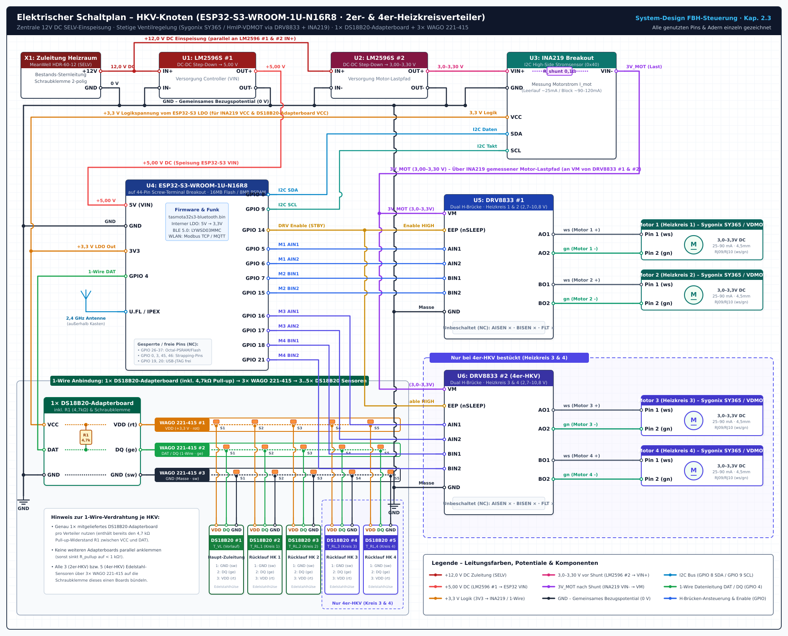

# System-Design: FBH-Steuerung (Heizen & Kühlen)

**Umfang:** 4 Heizkreisverteiler (2×2, 2×4 = 12 Kreise), 10 Räume, Wärmepumpe via Modbus TCP (Tasmota32-S3 / Berry).

## 1. Kernanforderungen & Randbedingungen

* **Mindestvolumenstrom (**$\dot{V}_{\min}$**):** Jederzeitige Sicherstellung für Wärmepumpe (Heizen, Kühlen, Abtauen) durch übergeordneten Override und lokalen Fail-Safe.

* **Stetige Ventilregelung (**$0\text{--}100\,\%$**):** $3{,}0\text{--}3{,}3\,\text{V}$ DC-Getriebemotoren (`Sygonix SY365` / `HmIP-VDMOT`, Leerlauf ca. $25\,\text{mA}$, Blockierstrom ca. $90\text{--}120\,\text{mA}$, Hub $4{,}3\text{--}4{,}5\,\text{mm}$); Positionsbestimmung über Strommessung (`INA219`) und Laufzeit; Topmeter voll geöffnet.

* **Kühlbetrieb:** Inverses Regelverhalten; rechnerische Taupunktüberwachung (Magnus-Formel + Sicherheitsmarge); Sperrung von Feuchträumen und Kreisen ohne aktuelle Sensordaten (*Max-Age-Check*).

* **Spannungsversorgung:** Zentrale $12\,\text{V DC}$ (SELV) Einspeisung im Heizraum über vorhandene Sternleitungen; keine $230\,\text{V}$ in den Verteilern.

* **Zweistufiges Deployment:**

  * *Phase 0/1 (Dumb Gateway):* ESP32-S3 als reiner Aktor-/Sensorknoten mit lokalen Hardware-Interlocks (Mutex, Max-Runtime, Current-Cutoff); Logik und Auto-Profiling laufen remote über Agenten.

  * *Phase 2/3 (Edge):* Migration der validierten Regelung als lokales Berry-Skript auf die ESP32-S3-Knoten.

## 2. System- und Hardware-Architektur

### 2.1 Topologie

```
[Heizraum]
  |-- Wärmepumpe (Modbus TCP Server)
  |-- Netzteil HDR-60-12 im Kleinverteiler (12V DC auf 4x Bestandsleitung)
        |---> HKV 1 (2 Kreise, Slave)
        |---> HKV 2 (2 Kreise, Slave)
        |---> HKV 3 (4 Kreise, Slave)
        +---> HKV 4 (4 Kreise, Master: WP-Kommunikation & Koordinator)
                ^
                +-- BLE 5.0 Empfang: 10x Raumsensor (LYWSD03MMC, Temp + rH%)

```

### 2.2 Aufbau je HKV-Knoten

* **Controller:** `ESP32-S3-WROOM-1U-N16R8` (16 MB Flash, 8 MB Octal-PSRAM, BLE 5.0) auf 44-Pin Schraubklemmen-Breakout, Firmware `tasmota32s3-bluetooth.bin` (nutzt PSRAM automatisch für Berry-VM & BLE-Stack).

* **DC-DC Wandler 1 (**$12\,\text{V} \rightarrow 5{,}0\,\text{V}$**):** Speist ESP32-S3 (`5V/VIN`). $3{,}3\,\text{V}$ Logikspannung für `INA219` und `DS18B20`-Adapterboard kommt vom ESP32-S3-LDO.

* **DC-DC Wandler 2 (**$12\,\text{V} \rightarrow 3{,}00\text{--}3{,}30\,\text{V}$**):** Speist über `INA219` (`VIN+`/`VIN-`) den Motortreiber-Lastpfad (`VM`).

* **1-Wire Anbindung:** 1× `DS18B20`-Adapterboard (mit integriertem $4{,}7\,\text{k}\Omega$ Pull-up und Schraubklemme) je HKV; Bündelung der 3 bzw. 5 Sensoren über 3× WAGO 221-415 auf dieses eine Adapterboard.

* **Motortreiber:** 1× (2er-HKV) bzw. 2× (4er-HKV) `DRV8833` ($2{,}7\text{--}10{,}8\,\text{V}$, benötigt keine separate Logikspannung; `AISEN/BISEN/FLT` bleiben unbeschaltet).

* **Gehäuse:** Kompaktes Aufputz-Abzweiggehäuse (IP54/IP65 mit Gummimembran-Einführungen, z. B. Spelsberg Abox / Hensel, ca. $150 \times 110 \times 70\,\text{mm}$), Befestigung im HKV-Blechkasten per Magnetfüßen oder Klettband; externe WLAN/BLE-Antenne nach außen geführt.

### 2.3 Elektrischer Schaltplan (je HKV-Knoten)



### 2.4 Pinbelegung ESP32-S3 (N16R8)

*Hinweis:* `GPIO 26–37` sind beim `N16R8` intern durch Octal-Flash/PSRAM belegt und dürfen nicht beschaltet werden; `GPIO 0, 3, 45, 46` (Strapping) sowie `GPIO 19, 20` (USB-JTAG) bleiben frei.

| Pin | Verbindung | Funktion | 
| ----- | ----- | ----- | 
| `5V (VIN)`, `GND` | Step-Down 1 ($5{,}0\,\text{V}$) | Versorgung ESP32-S3 | 
| `3V3` | `INA219` (`VCC`), 1× `DS18B20`-Adapterboard (`VCC`) | $3{,}3\,\text{V}$ Logik | 
| `GPIO 8 / 9` | `INA219` (`SDA / SCL`) | I2C Strommessung (S3-Standard) | 
| `GPIO 4` | 1× `DS18B20`-Adapterboard (`DAT`, Pull-up integriert) | 1-Wire ($1\times T_{VL}$, $2\text{--}4\times T_{RL}$) | 
| `GPIO 5, 6` | `DRV8833 #1` (`AIN1, AIN2`) | Motor Kreis 1 | 
| `GPIO 7, 15` | `DRV8833 #1` (`BIN1, BIN2`) | Motor Kreis 2 | 
| `GPIO 16, 17` | `DRV8833 #2` (`AIN1, AIN2`) | Motor Kreis 3 *(nur 4er-HKV)* | 
| `GPIO 18, 21` | `DRV8833 #2` (`BIN1, BIN2`) | Motor Kreis 4 *(nur 4er-HKV)* | 
| `GPIO 14` | `DRV8833 #1 & #2` (`EEP` / `nSLEEP`) | Treiber-Enable (`HIGH` = aktiv) | 

## 3. Stückliste (BOM) & Kosten

| Pos. | Artikel | Menge | Einzelpreis | Gesamt | Hinweis | 
| ----- | ----- | ----- | ----- | ----- | ----- | 
| 1 | `Sygonix SY365` (`SY-6807138`) motorischer Stellantrieb ($3\,\text{V DC}$, $25\text{--}90\,\text{mA}$, $4{,}5\,\text{mm}$ Hub, RJ09/RJ10) | 12 | 9,79 € | 117,50 € | Baugleich zu `HmIP-VDMOT` ($\le 44\,\text{mm}$); ab 5 Stk. 9,79 € bei Voelkner/Conrad | 
| 2 | `ESP32-S3-WROOM-1U-N16R8` + Screw-Terminal + Antenne\\ https://amzn.eu/d/05I7vqJh | 4 | 11,00 € | 44,00 € | 8 MB PSRAM, Antenne außerhalb Blechkasten | 
| 3 | `DRV8833` Dual-Motortreiber Breakout\\ https://amzn.eu/d/0gCWyFN3 | 6 | Set (1,17 €) | 7,00 € | Je 1× für 2er-HKV, je 2× für 4er-HKV ($2{,}7\text{--}10{,}8\,\text{V}$) | 
| 4 | `INA219` I2C-Stromsensor Breakout\\ https://amzn.eu/d/0gUydp1c | 4 | Set (2,25 €) | 9,00 € | In $3{,}0\text{--}3{,}3\,\text{V}$ Motor-Zuleitung (`VM`) | 
| 5 | MeanWell `HDR-60-12` ($12\,\text{V}$, $4{,}5\,\text{A}$, 3 TE) | 1 | 21,00 € | 21,00 € | Zentral im Heizraum | 
| 6 | `LM2596S` DC-DC Step-Down-Modul\\ https://amzn.eu/d/02fINAyO | 8 | Set (1,63 €) | 13,00 € | 2× je HKV ($5{,}0\,\text{V}$ & $3{,}00\text{--}3{,}30\,\text{V}$) | 
| 7 | `DS18B20` Edelstahlhülse (1 m) inkl. Adapterboard ($4{,}7\,\text{k}\Omega$) | 16 | 1,50 € | 24,00 € | 4× Vorlauf, 12× Rücklauf (je 1 Adapterboard pro HKV genutzt) | 
| 8 | Xiaomi Mijia `LYWSD03MMC` (BLE)\\ https://de.aliexpress.com/item/4000406818501.html | 10 | 5,50 € | 55,00 € | OTA-Flash auf *pvvx/ATC* Firmware | 
| 9 | **Gehäuse HKV-Knoten:** Aufputz-Abzweigkasten IP65 ($150 \times 110 \times 70\,\text{mm}$, Gummimembranen, z. B. Spelsberg Abox 100 / OBO T100) | 4 | 6,50 € | 26,00 € | Nimmt ESP32-Breakout, 2× LM2596, INA219, DRV8833 & Wago-Klemmen auf | 
| 10 | **Gehäuse Heizraum:** Kleinverteiler Aufputz 1-reihig (4–6 TE, IP65, inkl. Hutschiene & PE/N-Klemme) | 1 | 9,50 € | 9,50 € | Für MeanWell `HDR-60-12` und normgerechte 12V-Sternverteilung | 
|  |  |  |  |  |  | 
| **Summe** |  |  |  | **326,00 €** | *(Ersparnis gegenüber `HmIP-VDMOT`: \~90 €)* | 

## 4. Dumb Gateway Spezifikation (Phase 0 & 1)

### 4.1 Kommandos (HTTP / MQTT)

* **`RawDrive`:** `{"ch":1..4, "dir":"open"|"close", "max_ms":5000, "cutoff_ma":150, "inrush_ms":100, "sample_ms":25}`

  * Erzwingt Mutex (nur 1 Kanal aktiv), blendet Einschaltstrom für `inrush_ms` aus, tastet Strom alle `sample_ms` ab, stoppt bei $I \ge \text{cutoff\_ma}$ oder `max_ms` (Cap: $35\,000\,\text{ms}$).

  * Response: `{"RawDrive": {"ch":1, "dir":"close", "stop_reason":"CURRENT_CUTOFF"|"TIME_LIMIT", "elapsed_ms":..., "peak_ma":..., "trace_ma":[...]}}`

* **`RawStop`:** Schaltet `EEP` (`STBY`) und alle Motor-Pins sofort auf `LOW`.

* **`Status 10`:** Tasmota-Standardabfrage für `DS18B20` und BLE-Sensoren.

### 4.2 Referenz-Code (`gateway.be` für ESP32-S3)

```
import json
import string
import math

class DumbValveGateway
  var wire, ina_addr, pin_stby, ch_pins, is_moving

  def init()
    self.ina_addr = 0x40
    self.pin_stby = 14
    self.ch_pins = {1:[5,6], 2:[7,15], 3:[16,17], 4:[18,21]}
    self.is_moving = false
    gpio.pin_mode(self.pin_stby, gpio.OUTPUT)
    gpio.digital_write(self.pin_stby, gpio.LOW)
    for ch: self.ch_pins.keys()
      for p: self.ch_pins[ch]
        gpio.pin_mode(p, gpio.OUTPUT)
        gpio.digital_write(p, gpio.LOW)
      end
    end
    self.wire = tasmota.wire_scan(self.ina_addr)
    tasmota.add_cmd('RawDrive', /cmd, idx, payload -> self.cmd_raw_drive(payload))
    tasmota.add_cmd('RawStop',  /cmd, idx, payload -> self.cmd_raw_stop())
  end

  def stop_all()
    gpio.digital_write(self.pin_stby, gpio.LOW)
    for ch: self.ch_pins.keys()
      gpio.digital_write(self.ch_pins[ch][0], gpio.LOW)
      gpio.digital_write(self.ch_pins[ch][1], gpio.LOW)
    end
    self.is_moving = false
  end

  def read_current_ma()
    if !self.wire return -1.0 end
    var raw = self.wire.read(self.ina_addr, 0x01, 2)
    if raw == nil return -1.0 end
    if raw > 32767 raw -= 65536 end
    return math.abs(real(raw) * 0.1)
  end

  def cmd_raw_stop()
    self.stop_all()
    tasmota.resp_cmnd(json.dump({"RawStop": "OK"}))
  end

  def cmd_raw_drive(payload)
    if self.is_moving
      tasmota.resp_cmnd(json.dump({"error": "BUSY"}))
      return
    end
    var p = json.load(payload)
    if p == nil || !p.contains("ch") || !p.contains("dir")
      tasmota.resp_cmnd(json.dump({"error": "INVALID_ARGS"}))
      return
    end

    var ch = int(p["ch"])
    var dir = str(p["dir"])
    var max_ms = p.contains("max_ms") ? int(p["max_ms"]) : 5000
    if max_ms > 35000 max_ms = 35000 end
    var cutoff_ma = p.contains("cutoff_ma") ? real(p["cutoff_ma"]) : 150.0
    var inrush_ms = p.contains("inrush_ms") ? int(p["inrush_ms"]) : 100
    var sample_ms = p.contains("sample_ms") ? int(p["sample_ms"]) : 25

    self.stop_all()
    self.is_moving = true
    var pins = self.ch_pins[ch]
    gpio.digital_write(pins[0], dir == "open" ? gpio.HIGH : gpio.LOW)
    gpio.digital_write(pins[1], dir == "open" ? gpio.LOW : gpio.HIGH)
    gpio.digital_write(self.pin_stby, gpio.HIGH)

    var start_t = tasmota.millis()
    var trace = []
    var peak_ma = 0.0
    var stop_reason = "TIME_LIMIT"

    while (tasmota.millis() - start_t) < max_ms
      var cur = self.read_current_ma()
      trace.push(cur)
      if cur > peak_ma peak_ma = cur end
      if (tasmota.millis() - start_t) > inrush_ms && cur >= cutoff_ma
        stop_reason = "CURRENT_CUTOFF"
        break
      end
      tasmota.delay(sample_ms)
    end

    var elapsed = tasmota.millis() - start_t
    self.stop_all()
    tasmota.resp_cmnd(json.dump({
      "RawDrive": {"ch":ch, "dir":dir, "stop_reason":stop_reason, "elapsed_ms":elapsed, "peak_ma":peak_ma, "sample_ms":sample_ms, "trace_ma":trace}
    }))
  end
end

return DumbValveGateway()

```

## 5. Steuerungslogik

### 5.1 Schicht 1: Auto-Profiling & Motor-Kalibrierung

1. **Initialer Testpuls (Auto-Profiling):**

   * Kurzer Fahrbefehl (`max_ms: 1500`, `cutoff_ma: 400`). Bei sofortigem Blockierstrom ($< 150\,\text{ms}$) Richtung umkehren.

   * Berechnung von Mittelwert $I_{\text{free}}$ und Standardabweichung $\sigma_{\text{free}}$ im freien Lauf ($t > t_{\text{inrush}}$).

   * Ableitung der kanalspezifischen Schwellenwerte:

     $$
     I_{\text{stall, open}} = 2{,}2 \cdot I_{\text{free}}, \quad I_{\text{stall, close}} = 2{,}5 \cdot I_{\text{free}}, \quad \Delta I_{\text{touch}} = \max(0{,}35 \cdot I_{\text{free}}, \; 4 \cdot \sigma_{\text{free}})
     $$

2. **Drei-Punkt-Kalibrierung (Initial & alle 24 h):**

   * **Oberer Anschlag (**$t = 0$**):** Richtung *Auf* bis $I \ge I_{\text{stall, open}}$.

   * **Touch-Point (**$u = 100\,\%$**):** Richtung *Zu*; Zeitpunkt $t_{\text{touch}}$, sobald gleitender Mittelwert (5 Samples) $\ge I_{\text{free}} + \Delta I_{\text{touch}}$.

   * **Schließpunkt (**$u = 0\,\%$**):** Weiter Richtung *Zu* bis $I \ge I_{\text{stall, close}}$ bei $t_{\text{close}}$. Schließ-Arbeitshub: $T_{\text{hub, zu}} = t_{\text{close}} - t_{\text{touch}}$.

   * **Öffnungs-Arbeitshub:** Komplettfahrt von $0\,\%$ bis oberer Anschlag ($t_{\text{open, total}}$). Mit $\eta_{\text{work}} = \frac{T_{\text{hub, zu}}}{t_{\text{close}}}$ gilt:

     $$
     T_{\text{hub, auf}} = \eta_{\text{work}} \cdot t_{\text{open, total}}
     $$

3. **Positionsanfahrt im Betrieb:**

   $$
   \Delta t = \frac{\vert u_{\text{neu}} - u_{\text{alt}} \vert}{100} \cdot \begin{cases} T_{\text{hub, auf}} & \text{für } u_{\text{neu}} > u_{\text{alt}} \\ T_{\text{hub, zu}} & \text{für } u_{\text{neu}} < u_{\text{alt}} \end{cases}
   $$

   Bei Ziel $0\,\%$ oder $100\,\%$ Fahrt bis $I_{\text{stall}}$ zur Drift-Eliminierung.

### 5.2 Schicht 2: $\Delta T$-Abgleich & Raumaufschaltung (Intervall: 10 Min.)

Mehrkreis-Räume nutzen denselben Raum-Soll-/Istwert, regeln ihre Ventile aber separat nach ihrer jeweiligen Rücklauftemperatur $T_{RL, i}$. Totzone für Ventilbewegungen: $\vert e_{\Delta T, i} \vert > 0{,}2\,\text{K}$.

* **Heizbetrieb (`MODE_HEAT`):**

  $$
  \Delta T_{\text{ist}, i} = T_{VL, \text{HKV}} - T_{RL, i}
  $$

  $$
  \Delta T_{\text{soll}, i} = \text{clip}\Big(\Delta T_{\text{WP, soll}} - K_{p, \text{room}} \cdot (T_{r, \text{soll}} - T_{r, \text{ist}}), \; 1{,}5\,\text{K}, \; 8{,}0\,\text{K}\Big)
  $$

  $$
  u_i(k) = \text{clip}\Big(u_i(k-1) + K_{I, \text{flow}} \cdot (\Delta T_{\text{ist}, i} - \Delta T_{\text{soll}, i}), \; u_{\min, i}, \; 100\,\%\Big)
  $$

* **Kühlbetrieb (`MODE_COOL`):**

  * **Taupunkt je Raum** $r$ **(Magnus-Formel,** $a = 17{,}62$**,** $b = 243{,}12\,^\circ\text{C}$**):**

    $$
    \gamma(T_r, \varphi_r) = \ln\left(\frac{\varphi_r}{100}\right) + \frac{a \cdot T_r}{b + T_r}, \qquad T_{dp, r} = \frac{b \cdot \gamma(T_r, \varphi_r)}{a - \gamma(T_r, \varphi_r)}
    $$

  * **Kritischer Taupunkt je Kreis** $i$ **am Verteiler** $k$ **(inkl. Aufstellraum** $r_{\text{host}}(k)$**):**

    $$
    T_{dp, \text{krit}, i} = \max\Big(T_{dp, r(i)}, \; T_{dp, r_{\text{host}}(k)}\Big)
    $$

  * **Schutzregeln:**

    * WP-Vorlaufbegrenzung via Modbus TCP: $T_{VL, \text{WP, soll}} \ge \max\left(18{,}0\,^\circ\text{C}, \; \max_{r}(T_{dp, r}) + 2{,}0\,\text{K}\right)$.

    * Zwangs-Schließung ($u_i = 0\,\%$), falls `allow_cooling == false` (Bad), $T_{VL, \text{HKV}} \le T_{dp, \text{krit}, i} + 1{,}5\,\text{K}$ oder Raumsensor-Paket älter als $20\,\text{Min.}$

  * **Stellgesetz für freigegebene Kühlkreise (**$\Delta T_{\text{cool, ist}, i} = T_{RL, i} - T_{VL, \text{HKV}}$**):**

    $$
    \Delta T_{\text{cool, soll}, i} = \text{clip}\Big(\Delta T_{\text{WP, cool}} - K_{p, \text{cool}} \cdot (T_{r, \text{ist}} - T_{r, \text{soll, cool}}), \; 1{,}5\,\text{K}, \; 6{,}0\,\text{K}\Big)
    $$

    $$
    u_i(k) = \text{clip}\Big(u_i(k-1) + K_{I, \text{flow}} \cdot (\Delta T_{\text{cool, ist}, i} - \Delta T_{\text{cool, soll}, i}), \; 0\,\%, \; 100\,\%\Big)
    $$

### 5.3 Schicht 3: WP-Koordinator (Master-Node) & Fail-Safe

* **Ventilstellungs-Normalisierung:** Falls $\max(u_i) < 90\,\%$, Skalierung aller aktiven Ventile mit Faktor $\frac{95\,\%}{\max(u_i)}$.

* $\dot{V}_{\min}$**-Override:**

  * *Heizen:* Falls $\dot{V}_{\text{ist}} < \dot{V}_{\min} + 1{,}5\,\text{l/min}$, schrittweises Öffnen definierter Pufferkreise (Flur, Bad, Wohnen).

  * *Abtauen (`DEFROST_ACTIVE`):* Alle Kreise (außer gesperrten Schlafräumen) sofort auf $u_i \ge 85\,\%$.

  * *Kühlen:* Falls $\dot{V}_{\text{ist}} < \dot{V}_{\min}$, **kein** Öffnen taupunktgesperrter Kreise; stattdessen Anhebung von $T_{VL, \text{WP, soll}}$ bzw. Sperrung der Kühlfreigabe via Modbus TCP.

* **Lokaler Watchdog:** Nach $15\,\text{Min.}$ ohne Master-/Agenten-Heartbeat fahren alle HKV-Knoten ihre Ventile in eine feste Fallback-Stellung ($\ge 60\,\%$ im Heizbetrieb, $0\,\%$ im Kühlbetrieb).

## 6. Umsetzungsplan

* **Phase 0 – Testaufbau & Auto-Profiling (Woche 1):**

  * Aufbau 1× S3-Knoten am Schreibtisch; Einstellung Step-Downs ($5{,}00\,\text{V}$ / $3{,}00\text{--}3{,}30\,\text{V}$); Flash `tasmota32s3-bluetooth.bin`; Deployment `gateway.be`.

  * Remote-Entwicklung der Auto-Profiling- und Kalibrierlogik durch Agenten; Speicherung der Ventilparameter (`valve_profile.json`).

* **Phase 1 – MVP am 2er-Verteiler (Woche 2):**

  * Montage des 1-reihigen Kleinverteilers im Heizraum und Umklemmen der ersten Verteilerzuleitung auf $12\,\text{V DC}$; Einbau des ersten Knotens im IP65-Abzweiggehäuse am 2er-HKV.

  * Remote-Regelung ($\Delta T$-Abgleich + WP-Modbus-Abfrage) durch Agenten; Ziel: Angleichung der Rücklauftemperaturen auf $\pm 0{,}3\,\text{K}$.

* **Phase 2 – Migration auf ESP32-S3 & Rollout (Woche 3–4):**

  * Portierung der verifizierten Logik nach Berry (`autoexec.be`) und Upload auf den ESP32-S3.

  * Ausbau der restlichen 3 Verteiler; Offset-Abgleich der `DS18B20` im Wasserbad; Flash der 10 `LYWSD03MMC` auf *pvvx* und Aktivierung von `MI32`.

* **Phase 3 – Koordinator & Kühlbetrieb (Woche 5):**

  * Einbindung der Modbus-TCP-Berry-Library auf Master-ESP32-S3 (HKV 4).

  * Test von $\dot{V}_{\min}$-Override, Abtau-Freigabe, Taupunkt-Sperre und Watchdog-Fallback.